# SemuBot Operating Instructions

## Network / IP Addresses

| Device | IP | Username | Password |
|---|---|---|---|
| SemuBot V1 — NUC | 192.168.0.90 | semubot | semubot |
| SemuBot V1 — RPi | 192.168.0.82 | semubot | semubot |
| SemuBot V2 — RPi | 192.168.0.202 | semubot | semubot |
| Big PC | 192.168.0.172 | semubot | semubot |

---

## 1. Powering On

### Wheelbase / driving battery
* To charge the battery, connect the big blue charger to the 2 pin black and red wire coming out of the robot's body.

### V1
> **Cabling check (NUC):** both display cables must use the ports marked **1** on the NUC:
> - The **head** USB-C cable → NUC **USB-C port 1** (Thunderbolt ⚡).
> - The **chest display** HDMI cable → NUC **HDMI port 1**.
>
> 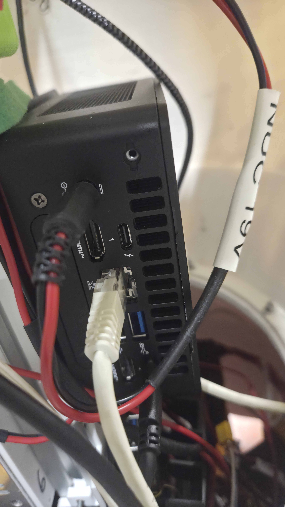

1. Flip the **red switch** inside the robot's body.

   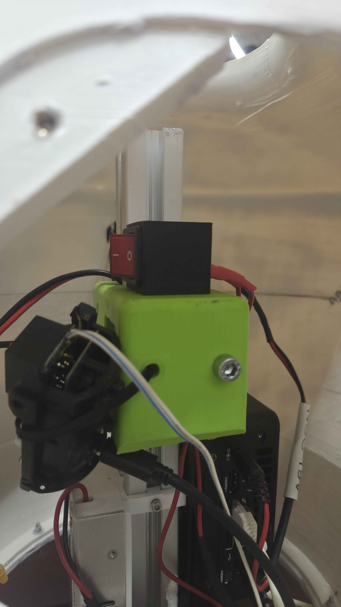

2. The NUC and Raspberry Pi turn on automatically.
3. If all cables are connected correctly, the robot's face should appear on screen.


### V2
*(power-on instructions TBD)*

---

## 2. Driving the SemuBot
*(same procedure for V1 and V2)*

1. Turn on the Xbox controller — **white** for V1, **pink** for V2.
2. Release the **red Stop button** on the robot.
3. Hold down the **deadman switch**, the **RB** button (right bumper, top-right of the controller; **R1** on a DualShock), and use the joysticks to drive. The robot stops when you let go.

   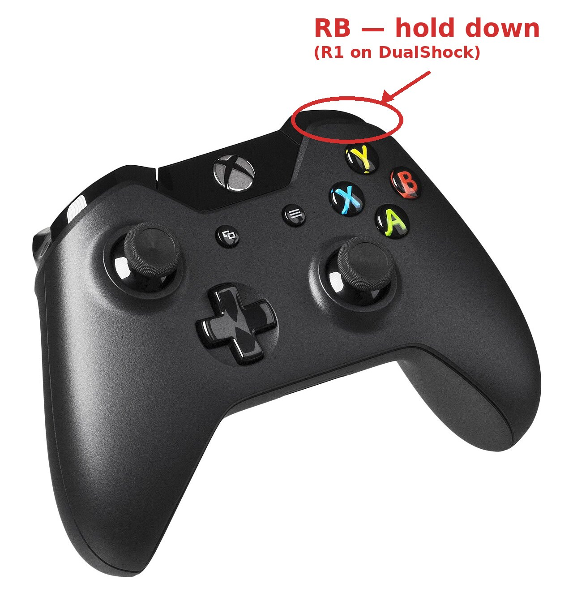

   <sub>Controller photo: Evan-Amos, public domain, via Wikimedia Commons.</sub>

---

## 3. Connecting via SSH

1. Make sure the robot and your computer are on the same network: **"semubot"**.
   - The router's Wi-Fi password is **75883478**.
2. Connect:
   ```
   ssh semubot@192.168.0.90
   ```
   - If asked for a password, it is **semubot**.

   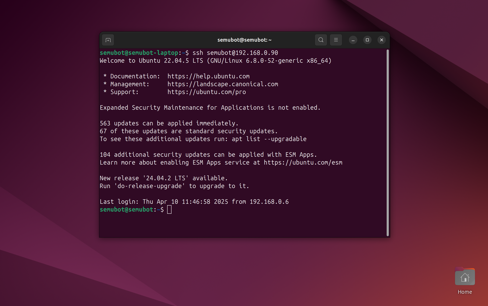

   - If using the SemuBot laptop, you can instead just run:
     ```
     ssh nuc
     ```

     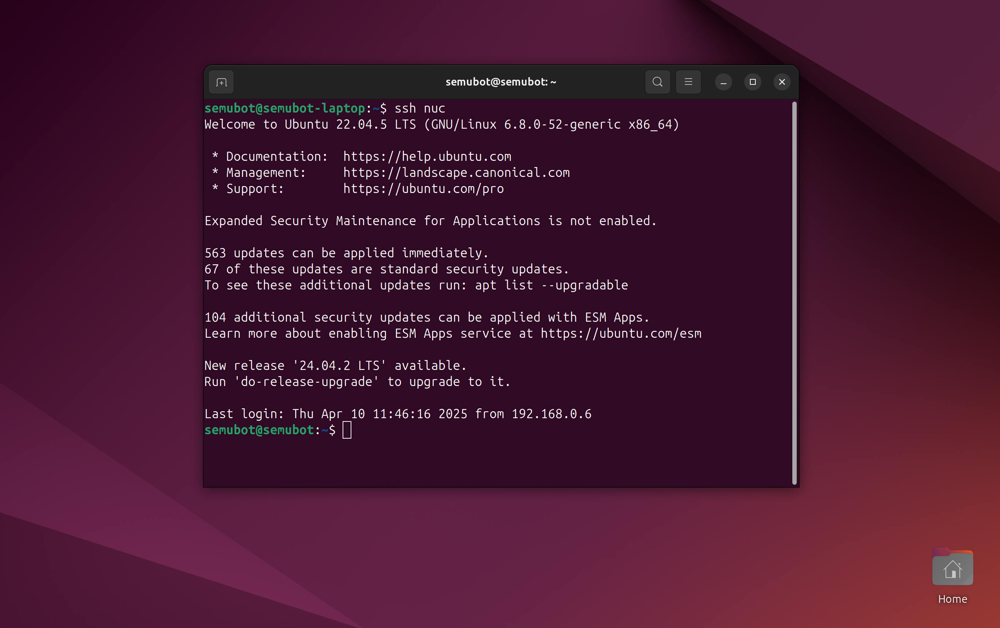

   When you see the `semubot@semubot:~$` prompt, you are connected.

---

## 4. Audio Commands
> All commands below require an active SSH connection to the SemuBot onboard computer.

### Play the built-in greeting
```
sayhi
```
Runs the long/default greeting.

> **Known issue (should be fixed):** if audio doesn't play, try unplugging and re-plugging the USB-C dock — by default, the most recently connected audio device becomes the system default.

### Play a custom text file
```
playfile <textfile.txt>
```
Write your text into a `.txt` file and pass it in (replace `textfile.txt` with your filename).
To read a text file with `speak`, run:
```bash
speak "$(cat textfile.txt)"
```

### Speak custom text directly
```
speak "This is an example sentence, that the robot will speak"
```
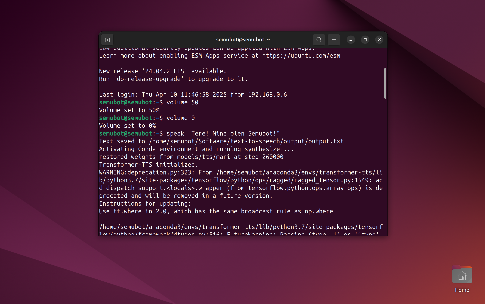

- **Quotation marks are required.**
- `speak` sends the text to the speech service at `http://localhost:8001/v2` on the NUC, using the `mari` voice and speed `1`, then plays the returned WAV. The service must be running; the request has a 300-second timeout.
- Run generation commands one at a time: they share the latest text and audio files at `/home/semubot/Software/text-to-speech/output/output.txt` and `output.wav`.
- For more options:
  ```
  speak -h
  ```

### Save and reuse named clips
Generate speech, save it under a name, and play it:
```bash
speak "Tere! Mina olen Semubot" --save hello
```
List saved clips and their original text:
```bash
speak --list
```
Play a saved clip without generating speech again:
```bash
speak -p hello
# Equivalent:
speak --play hello
```
Saved playback does not require the speech service. Clips are stored in `~/.local/share/speak/clips/NAME/`, with `audio.wav` and `metadata.json` containing the original text and creation time.

Names are case-sensitive and must contain 1–64 ASCII letters, digits, underscores, or hyphens, starting with a letter or digit. Existing names are rejected before synthesis; choose a different name to save new text. If a clip is missing, use `speak --list` to check available names.

### Set volume
```
volume 50
```
- Sets output volume to 50%.
- Valid range: **0–100** (10 is already quite quiet).

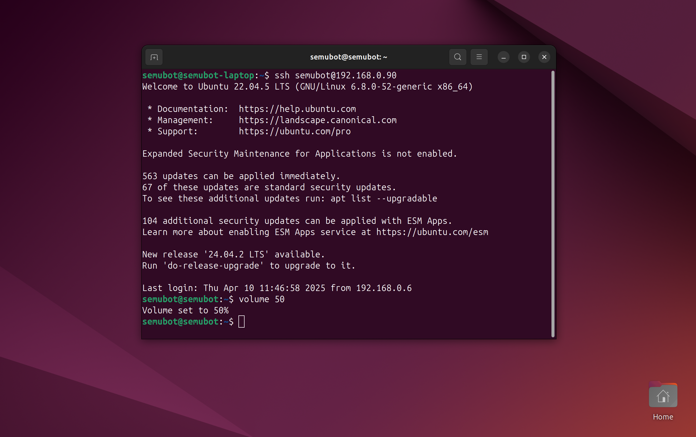

### Replay the last generated audio
Instantly replays the most recent `speak`-generated audio:
```
previous
```
or
```
speak -a
```

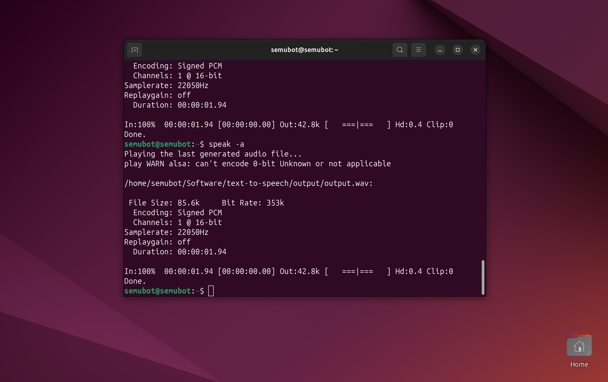

`speak --audio` is equivalent to `speak -a`. These replay the latest generated audio, while `speak -p NAME` plays a permanently saved clip. Neither regenerates speech or requires the speech service. Playing a named clip does not change which audio `speak -a` replays.

If synthesis fails, check that the speech service is running on the NUC at port `8001`. HTTP errors, timeouts, and responses without a WAV header leave the previous `output.wav` intact and skip playback.

---

## 5. Webapp (touch control)

The SemuBot webapp runs on the **NUC**. You can use it from a phone or tablet to drive the robot and send chat messages.

1. Connect your device to the **"semubot"** Wi-Fi network.
2. Open in a browser:
   ```
   http://192.168.0.90:8000
   ```
   - Or scan the QR code on the chest display instead of typing the address. The QR code always uses the robot's current IP, so it still works if the address above has changed:
     1. On the chest display, tap the **top-left corner twice, then the bottom-right corner three times**, and enter the admin PIN.

        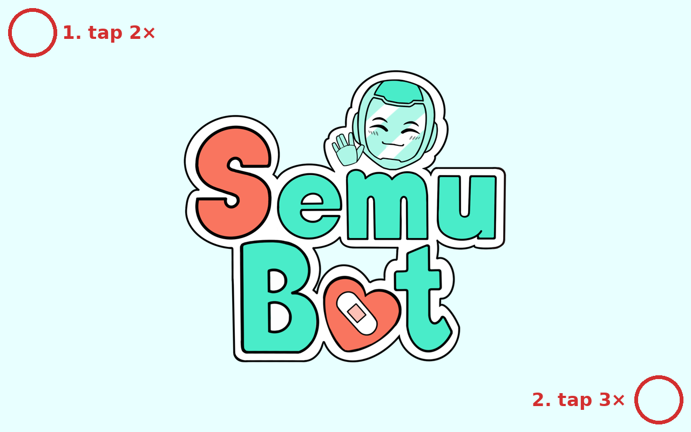

     2. In the admin menu, tap **QR-kood** (**QR code** in English) in the top-right corner.

        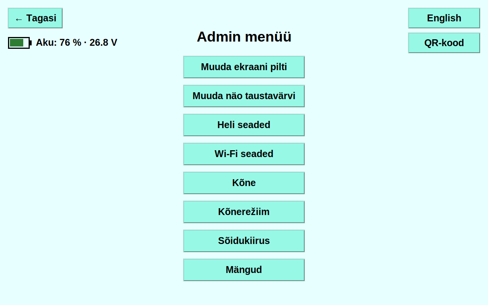

     3. Scan the QR code with your phone's camera.

        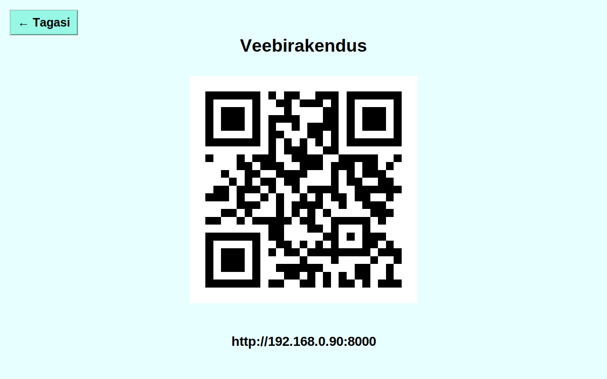

   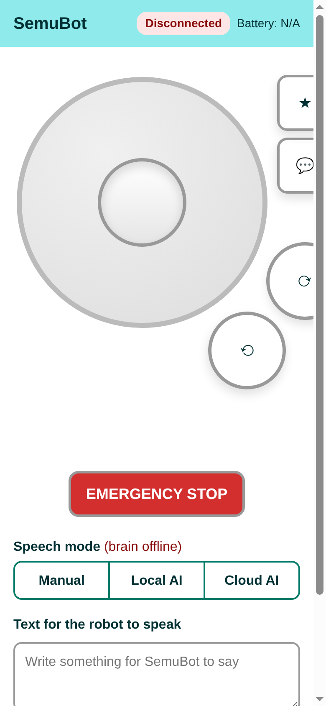

3. Use the joystick to drive, the rotate buttons to turn, and the chat button to make the robot speak predefined messages. The header shows the ROS connection status and battery level.

> The webapp works only on touch-capable devices. On a desktop browser the controls don't load.

---

## 6. Chest Display: Speech Mode and Microphone

Open the admin menu on the chest display: tap the **top-left corner twice, then the bottom-right corner three times**, and enter the admin PIN (see section 5).

### Switch between AIs
1. In the admin menu, tap **Kõnerežiim** (**Speech mode**).
2. Pick a mode. The active one is marked with **✓**:

   | Mode | What it does |
   |---|---|
   | **Käsitsi** (Manual) | Robot doesn't listen; it only says text you send it (e.g. `speak`). |
   | **Kohalik AI** (Local AI) | Robot listens and answers using its own language model on the NUC. |
   | **Pilve AI** (Cloud AI) | Robot listens and answers using a cloud model (Claude/OpenAI). Today's cloud usage is shown below the buttons. |

   If the screen says the speech system isn't responding, `semu_brain_node` isn't running on the robot.

### Calibrate the microphone
1. In **Kõnerežiim**, tap **Mikrofon →** at the bottom.
2. The bar shows the live sound level; the **red line** is the threshold. Quieter sounds than the threshold are ignored.
   - **Green** = robot hears speech and listens.
   - **Yellow** = speech detected, but too quiet (below the threshold).
   - **Grey** = no speech.
3. Tap **Kalibreeri** (**Calibrate**), then talk normally for **5 seconds** from where visitors will stand.
   The threshold is set to half your speech level and sent to the robot automatically.
4. If it says no speech was detected, try again closer to the robot.
5. To fine-tune by hand, drag the slider; the new threshold is sent when you let go.
   - Robot reacts to background noise → move the threshold **up**.
   - Robot ignores people talking → move the threshold **down**.

> Recalibrate whenever the robot is in a new place (e.g. a noisy event hall).
