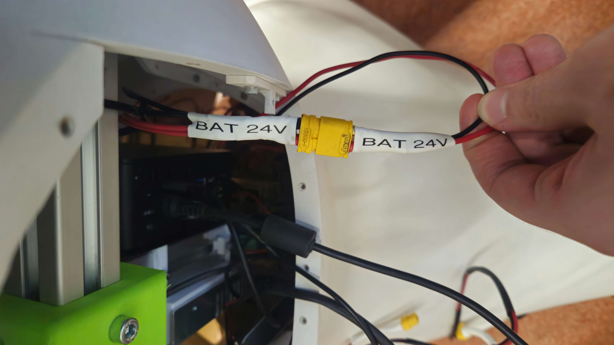
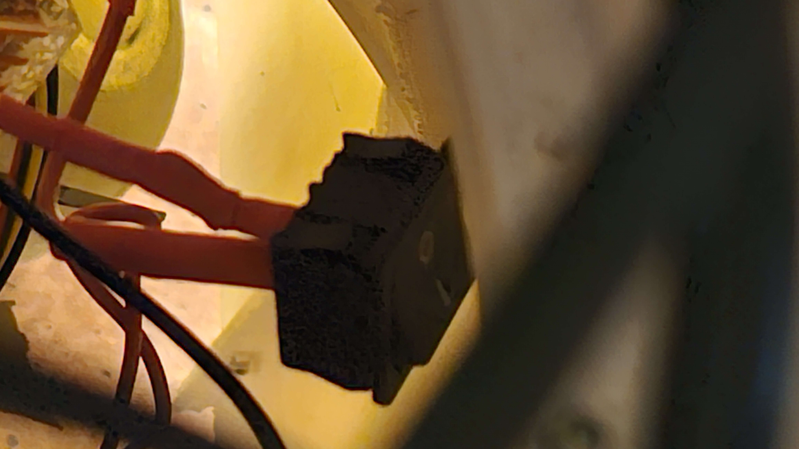
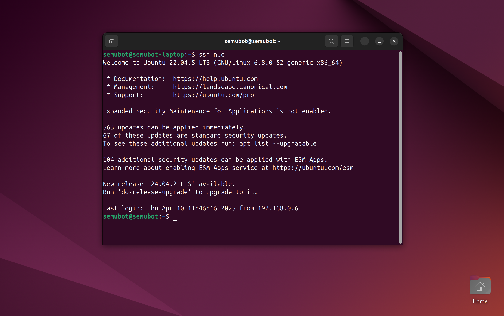
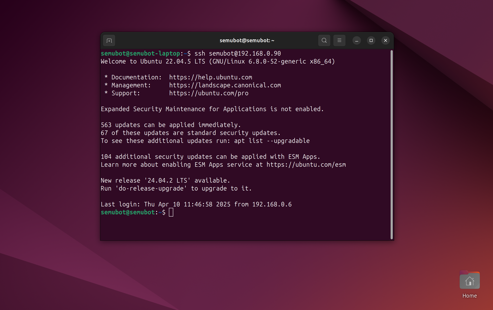
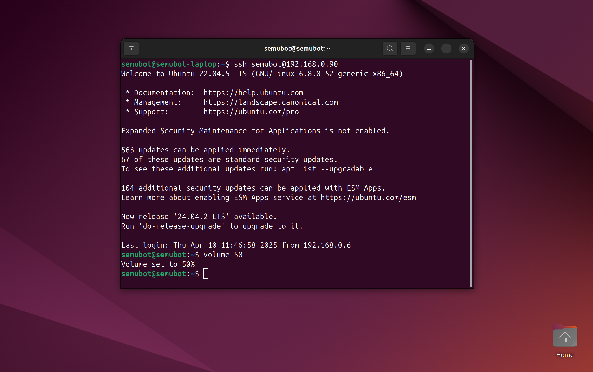
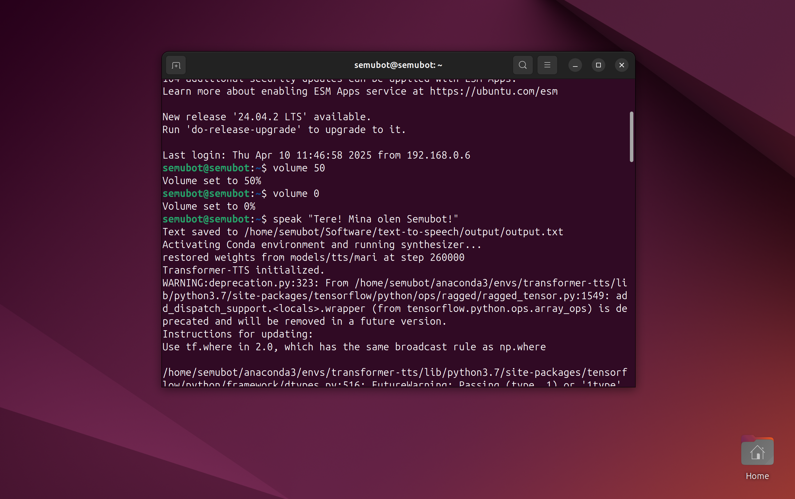
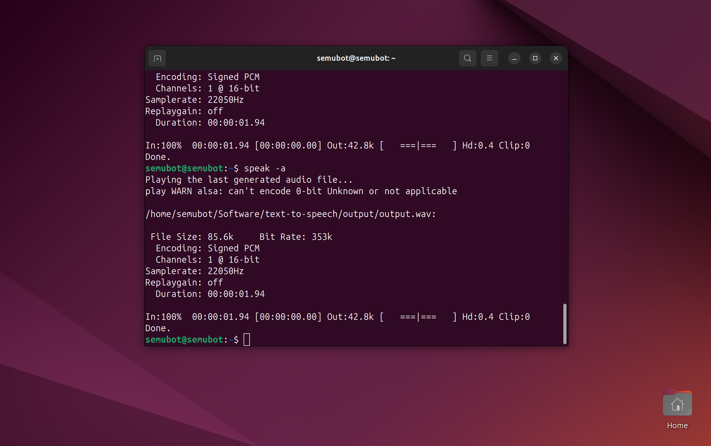

# Roboti kasutamine messidel


## Liikuma panemine

* Selleks, et robot liikuma hakkaks, tuleb roboti sees omavahel ühendada ** BAT 24V **




* Siis on tõenäosus olemas, et tuled lähevad sees põlema. Kui ei lähe, siis tuleb vajutada musta lülitit. Praegusel hetkel ta ripub roboti sees.



* Selle tulemusena peaksid tuled põlema minema.
* Siis tuleb ~30 sek oodata, panna pult tööle ja robot peaks liikuma hakkama, kui hoida LB nuppu all
* Kui robot ei liigu, siis tuleb roboti sees olev punane nupp lahti lasta ja selle tulemusena peaks ~ 5 sekundi pärast liikuma hakkama.

## Messi ettevalmistus

* Kõigepealt on mõistlik ühendada Semuboti ruuter vooluvõrku.
* Seejärel ühendada arvuti juhe arvuti endaga ja vooluvõrguga. Juhtme saab vedada läbi roboti, niimoodi et juhe tuleks roboti alt.
* Arvuti peaks seejärel ise automaatselt tööle minema. Kui ei lähe, siis tuleb manuaalselt käima panna. Startnupp on arvutil roboti rinna pool, üleval.
* Harvadel juhtudel ei tule automaatselt nägu robotile ette. Sel juhul on kõige lihtsam korra voolujuhe tagant ära võtta ja tagasi panna.


## Rääkima panemine

* Veendu et arvuti oleks Semuboti wifis. 
* Seejärel järgi kas Ubuntu või Windowsi juhendit


### Ubuntu

* Ava terminal, lühend on: "ctrl + alt + t"
* Loo ssh ühendus, kui kasutusel on Semuboti läpakad, saab kasutada käsku:

                
```
ssh nuc

```
Seejärel võiks avaneda järgnev vaatepilt:



* Kui käsk ei tööta, võib kasutada ka järgnevat:

```
ssh semubot@192.168.0.90

```

* Juhul kui pärast käsu jooksutamist küsib parooli, siis parool on **semubot**
* Nüüd peaks samuti olema samasugune vaatepilt.




#### Helitugevuse muutmine

* Heli saab muuta käsuga

```
volume 50

```


* See käsk paneb hääle tugevuseks 50. Valida saab vahemikus 0-100.


#### Rääkima panemine

* Vaikimisi tervituse saab käivitada käsuga

```
sayhi

```
* Antud käsk paneb roboti rääkima pika teksti.
* Enda teksti saab rääkima panna käsuga

```
speak "Tere! Mina olen Semubot"

```
* Kus siis jutumärkide vahele saab panna oma teksti


* Käsk saadab teksti NUC-is töötavale kõnesünteesiteenusele aadressil `http://localhost:8001/v2`, kasutades häält `mari` ja kiirust `1`, ning mängib saadud WAV-faili ette. Teenus peab töötama; päringu ajalimiit on 300 sekundit.
* Käivita sünteesikäsud ükshaaval, sest need kasutavad samu viimase teksti ja heli väljundfaile.
* Tekstifaili sisu saab sama teenusega ette lugeda nii:

```bash
speak "$(cat tekst.txt)"
```

* Sama käsuga saab rääkima panna ka eelmist "speak" käsu tulemust
* Seda saab käsuga:

```
speak -a
```

* Sama teeb `speak --audio`. See mängib viimase sünteesitud heli ette ilma uue sünteesita ega vaja töötavat kõnesünteesiteenust.



#### Nimega heliklippide salvestamine ja esitamine

* Teksti sünteesimiseks, nimega salvestamiseks ja ettemängimiseks kasuta:

```bash
speak "Tere! Mina olen Semubot" --save hello
```

* Salvestatud nimede ja algtekstide vaatamiseks:

```bash
speak --list
```

* Salvestatud klipi esitamiseks ilma uue sünteesita:

```bash
speak -p hello
# Sama käsk pikemal kujul:
speak --play hello
```

* Salvestatud klipi esitamine ei vaja kõnesünteesiteenust ega muuda heli, mida esitab `speak -a`.
* Klipid asuvad NUC-is kaustas `~/.local/share/speak/clips/NIMI/`: `audio.wav` ja algteksti ning loomisaega sisaldav `metadata.json`.
* Nimi peab algama ASCII tähe või numbriga ning sisaldama 1–64 ASCII tähte, numbrit, alakriipsu või sidekriipsu. Suur- ja väiketähti eristatakse. Olemasolevat nime üle ei kirjutata; uue teksti jaoks vali uus nimi.
* Puuduva klipi korral kontrolli nimesid käsuga `speak --list`. Kõigi valikute abi näeb käsuga `speak -h` või `speak --help`.
* Sünteesivea korral kontrolli, et teenus töötaks NUC-i pordil `8001`. HTTP-vea, ajalimiidi ületamise või WAV-päiseta vastuse korral jääb eelmine helifail alles ja heli ei mängita ette.
